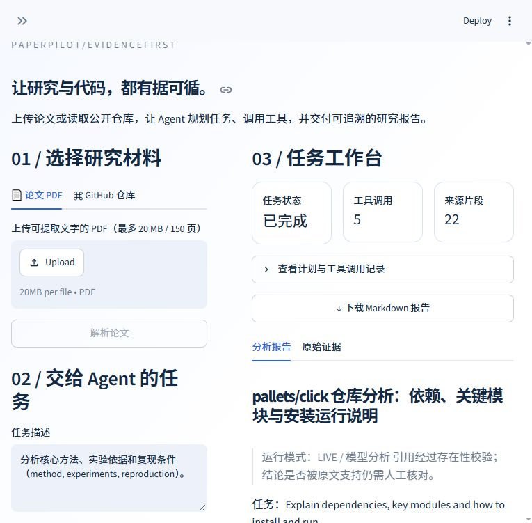

# PaperPilot Agent

[简体中文](README.md) · [Architecture](docs/architecture.md) · [Deployment](docs/deployment.md) · [Testing](docs/testing.md)

[](https://github.com/simabingci/PaperPilot-Agent/actions/workflows/ci.yml)

An evidence-grounded research and public-code assistant built with LangGraph,
LangChain, MCP v2, FastAPI and Streamlit. It reads text PDFs or a bounded snapshot
of a public GitHub repository, plans tool calls, retrieves evidence and exports a
Markdown report with physical PDF pages or commit-pinned file/line citations.

**Version 0.1.0 is a single-user workspace. Mock mode is the default: real ingestion,
retrieval and MCP calls, with explicitly labeled extractive evidence previews.
It performs no LLM reasoning. Live mode uses a configured OpenAI-compatible chat
endpoint or Ollama, and requires per-task consent before model data transmission.**

## Architecture

PDF / GitHub → source chunks in SQLite → consent → Skill-guided plan → MCP tool loop
→ structured synthesis → citation validation → Markdown.

One agent, five LangGraph nodes. SQLite checkpoints persist consent interrupts;
an append-only event table makes planning and tool execution inspectable. Jobs
interrupted by a service restart are marked failed explicitly; pending consent
can be resumed after restart. There is no fabricated success fallback.

- **PDF:** pypdf + LangChain chunking; physical page metadata; no OCR.
- **Repositories:** public GitHub API and an official commit-pinned codeload archive;
  up to 24 selected files, first 100 KB per file, 2 MB indexed text, 20 MB compressed
  archive. Root manifests and core source come first. Source scripts are never executed.
- **RAG:** character 2–4 gram sparse hashing vectors and cosine similarity on CPU.
  This is lexical vector retrieval, not semantic embeddings or cross-lingual search.
- **MCP:** official Python SDK **2.3.0**, `MCPServer` / `Client`, real stdio transport.
  Tools: `source_overview`, `paper_search`, `code_search`.
- **Skills:** two standard SKILL.md files, loaded into planning and synthesis;
  allowed tools constrain the plan. Tests exercise observable routing and prompts.
- **LLM:** LangChain `ChatOpenAI`; Pydantic-validated JSON plans and cited claims.
- **UI:** Chinese Streamlit interface, live task status, event log, raw evidence and
  Markdown download; FastAPI serves the backend.

Citation validation checks source ID existence. It cannot prove entailment or
eliminate hallucinations. Analysis is not a claim of successful code reproduction.



## Quick start

Use Python **3.12+**; the exact NumPy/SciPy lock requires 3.12.

```bash
python -m venv .venv
# Activate .venv using the command for your operating system.
python -m pip install -r requirements.lock
python -m pip install -e '.[dev]'
# Copy .env.example to .env; mock mode needs no API key.
python -m uvicorn paperpilot.api:create_app --factory --host 127.0.0.1 --port 8000
```

In another terminal, from the repository root:

```bash
python -m streamlit run paperpilot/ui.py --server.address 127.0.0.1 --server.headless true --browser.gatherUsageStats false
```

Visit `http://localhost:8501`; API docs are at `http://localhost:8000/docs`.
Use a single API worker. The queue admits eight jobs, with two concurrent executions.
The app itself needs no GPU. Local model resources depend on the selected model.

## Models and credentials

Run `python scripts/configure_model.py` to save credentials privately without
invoking a model, or set these environment variables:

```dotenv
PAPERPILOT_MODE=live
OPENAI_BASE_URL=https://your-compatible-provider/v1
OPENAI_MODEL=your-model-id
OPENAI_API_KEY=your-secret
```

For an existing local Ollama service, use `http://localhost:11434/v1` and `ollama`
as the key. Model output must follow JSON instructions. Invalid JSON and connection
errors fail visibly. Invalid citations receive at most one model correction;
a second rejection fails the task. Normal tasks use two model calls, or at most
three with correction. Network retries are disabled.
Never commit `.env` or runtime databases. The UI does not receive the model key.

## Tests and repeatable examples

```bash
python scripts/make_example.py
python -m pytest -q
ruff check .
# Against a running API, with real public GitHub access:
python scripts/smoke.py
```

The included PDF is an original, explicitly synthetic educational fixture under
MIT. It is not a published scientific study. Its second page states Adam with
learning rate 0.001. See [expected evidence](examples/expected.md).
Offline tests cover ingestion, retrieval, real MCP calls, graph execution,
consent persistence, rejected citations and tool restrictions. Model test doubles
verify contracts only; they are not real-model acceptance evidence.

## Deployment

```bash
docker compose up -d --build --wait
docker compose logs -f
docker compose down
```

Ports bind to loopback by default. SQLite data lives in a named volume. The image
runs as a non-root user. A Linux deployment without Docker is supported by
`deploy/install-user-service.sh /absolute/project /absolute/venv`.
See [deployment notes](docs/deployment.md) for SSH access and provider setup.

This instance shares all sources and history across its users. It has no multi-tenant
authentication or permission isolation; use a private SSH tunnel for the current
personal-workspace deployment. No repository code execution or general web search
is implemented. See [testing](docs/testing.md) for offline checks and optional
end-to-end verification against your configured service.

## Project map

`paperpilot/` contains the application and bundled Skills; `tests/` covers core
behavior; `scripts/` provides runnable examples; `deploy/` contains user-service
deployment; `docs/` documents architecture, deployment, testing and example reports.

Primary references: [LangGraph](https://docs.langchain.com/oss/python/langgraph/graph-api),
[MCP v2](https://py.sdk.modelcontextprotocol.io/client/),
[Agent Skills](https://agentskills.io/specification),
[LangChain ChatOpenAI](https://docs.langchain.com/oss/python/integrations/chat/openai).

MIT License. Imported documents and inspected repositories retain their original
rights and licenses; they are not relicensed or bundled by this project.
