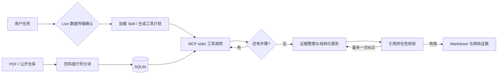

# PaperPilot Agent

[English](README.en.md) · [架构](docs/architecture.md) · [部署](docs/deployment.md) · [测试](docs/testing.md)

[](https://github.com/simabingci/PaperPilot-Agent/actions/workflows/ci.yml)

基于 LangGraph 和 MCP 的科研与公开代码分析助手。上传 PDF 或输入 GitHub
仓库地址，执行可观察的工具工作流，输出带页码或 commit 固定行号引用的 Markdown。

**状态：0.1.0，单用户工作区。默认 Mock 模式仅提供真实检索证据预览，
不调用模型，也不冒充模型分析。Live 模式支持 OpenAI 兼容聊天接口与 Ollama；
运行示例见下方报告与截图。**

## 工作流程



系统只有一个 Agent。LangGraph 使用 5 个有实际职责的节点：确认、计划、
工具执行循环、生成、引用审核；图的起止点由框架管理。
状态和确认暂停点保存在 SQLite；任务事件可由接口和页面查看。

## 能力与边界

| 能力 | 实现 |
|---|---|
| PDF 分析 | pypdf 提取文字，LangChain 切分，保留物理页码；不做 OCR |
| 代码分析 | GitHub API + 官方归档读取，固定 commit，优先核心源码，最多 24 个文件；不执行代码 |
| RAG | 字符 2–4 gram 稀疏哈希向量，余弦检索；无需 GPU 或 embedding API |
| MCP | 官方 Python SDK **2.3.0**：MCPServer + Client，真实 stdio 子进程通信 |
| Skills | 两个标准 SKILL.md；运行时加载正文、限制可用工具，进入规划和报告提示 |
| 模型 | LangChain ChatOpenAI；模型返回经过 Pydantic 校验的计划和报告 JSON |
| 引用 | 模型仅能引用实际检索的来源 ID；未知引用导致失败，不自动掩盖 |
| 交互 | FastAPI + 中文 Streamlit 页面，任务状态、工具记录、引用、报告下载 |

稀疏向量检索是词面检索，**不等于语义 embedding**，中英文跨语言问题建议附
英文关键词。引用存在性校验不能证明推理正确、引用蕴含或彻底解决幻觉。
报告不能替代全文精读或实际运行复现。当前不含任意互联网搜索、多租户、登录或沙箱执行。

## 安装与启动

Python 3.12+（锁定的 NumPy/SciPy 版本要求 3.12）。Windows PowerShell：

```powershell
py -3.12 -m venv .venv
.\.venv\Scripts\python -m pip install -r requirements.lock
.\.venv\Scripts\python -m pip install -e '.[dev]'
Copy-Item .env.example .env
.\.venv\Scripts\python -m uvicorn paperpilot.api:create_app --factory --host 127.0.0.1 --port 8000
```

另开终端，在项目根目录执行：

```powershell
.\.venv\Scripts\python -m streamlit run paperpilot/ui.py --server.address 127.0.0.1 --browser.gatherUsageStats false
```

Linux/macOS 使用 `python3 -m venv .venv`，将上面的解释器路径换为 `.venv/bin/python`。
打开 `http://localhost:8501`；API 文档位于 `http://localhost:8000/docs`。
始终使用单个 API worker，队列最多 8 个任务、最多 2 个并发执行。

## 配置真实模型

修改本地 `.env`，密钥只能由环境或本地配置提供，不提交 Git：

```dotenv
PAPERPILOT_MODE=live
OPENAI_BASE_URL=https://your-compatible-endpoint/v1
OPENAI_MODEL=your-model
OPENAI_API_KEY=your-local-secret
```

本地 Ollama 已有模型时，可改为：

```dotenv
PAPERPILOT_MODE=live
OPENAI_BASE_URL=http://127.0.0.1:11434/v1
OPENAI_MODEL=your-installed-model
OPENAI_API_KEY=ollama
```

百炼混合思考模型可另设 `PAPERPILOT_MODEL_EXTRA_BODY={"enable_thinking":false}`，
其他服务默认 `{}`。详见部署说明。

重启 API。每次 Live 任务在模型调用前暂停，页面确认后才发送任务与检索片段。
模型必须能遵守 JSON 指令；接口、限流、结构化输出不兼容时任务如实失败，
不会退回 Mock。正常任务调用模型两次；引用不合法时最多增加一次纠正请求，
仍无效则失败，不自动重试网络请求。应用本身不需要 GPU；Ollama 的资源需求取决于所选模型。
容器中 `localhost` 指容器自身，需使用模型服务的可达地址。

## 示例与测试

```bash
python scripts/make_example.py
python -m pytest -q
ruff check .
# API 已启动时，访问公开仓库并分析原创示例 PDF：
python scripts/smoke.py
```

示例 PDF 是明确标注的原创教育测试材料，不是发表过的研究结果。
预期页码与事实见 [examples/expected.md](examples/expected.md)。
默认测试不访问外网、不使用付费 API，包含真实 MCP 传输、图执行、
引用拒绝、确认拒绝及确认后重建图继续运行。
`ContractModel` 仅用于契约测试，不代表真实模型能力通过。

真实 Live 产物：[示例 PDF 报告](docs/examples/paper-report.md)、
[Click 仓库报告](docs/examples/repository-report.md)。
报告来自实际运行，不是预置成功结果。


另有 [Mock 模式界面](docs/screenshots/mock-paper.jpg)，展示无需模型 API 的检索预览。

## MCP 独立使用

```bash
python -m paperpilot.mcp_server
```

这是 stdio 服务，不能把普通日志输出到 stdout。工具包括 `source_overview`、
`paper_search`、`code_search`，操作已由 API 导入的来源。
客户端可用 `mcp.Client(StdioServerParameters(command=..., args=["-m", "paperpilot.mcp_server"],
env={"PAPERPILOT_DATA_DIR": "..."}))` 连接。完整可执行示例见测试。

## Docker 与服务器

```bash
docker compose up -d --build --wait
docker compose logs -f
docker compose down
```

访问端口默认只绑定 `127.0.0.1`，数据保存在命名卷。卷中是用户文档片段、任务和
checkpoint，不应上传到 GitHub。镜像使用普通用户执行，不包含任何密钥。
无 Docker 的 Linux 可使用 [部署脚本](deploy/install-user-service.sh) 启动隔离的
systemd 用户服务。服务器访问与重启方式见 [部署说明](docs/deployment.md)。

本版本面向个人工作区；服务实例中的历史和来源共享。公开多用户服务前需要另行
实现认证、访问隔离、反向代理和数据保留策略；目前使用 SSH 隧道访问即可。

## 工程结构

```text
paperpilot/       API、工作流、MCP、解析检索、存储和 UI
  skills/        实际加载的两个 SKILL.md
tests/           离线单元、MCP、图与 API 集成测试
scripts/         原创 PDF 生成器、真实服务 smoke 测试
examples/        可公开示例及预期事实
deploy/          用户级服务部署脚本
docs/            架构、部署、测试与示例报告
```

技术依据：[LangGraph Graph API](https://docs.langchain.com/oss/python/langgraph/graph-api)、
[MCP v2 客户端](https://py.sdk.modelcontextprotocol.io/client/)、
[Agent Skills 规范](https://agentskills.io/specification)、
[ChatOpenAI](https://docs.langchain.com/oss/python/integrations/chat/openai)、
[Ollama 兼容接口](https://docs.ollama.com/api/openai-compatibility)。
具体运行依赖固定在 `requirements.lock`；主库版本固定在 `pyproject.toml`。

MIT License。原始论文和被分析仓库仍遵循各自权利与许可，不随本项目重新授权。
