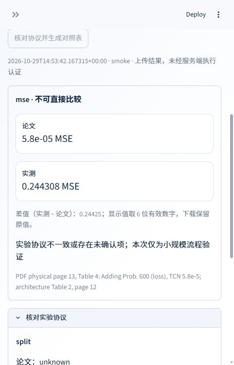
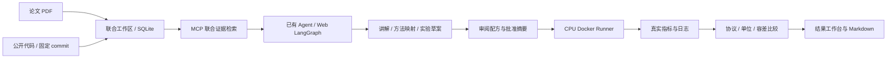

# PaperPilot Agent

[English](README.en.md) · [架构](docs/architecture.md) · [复现流程](docs/reproduction.md) · [部署](docs/deployment.md) · [测试](docs/testing.md)

[](https://github.com/simabingci/PaperPilot-Agent/actions/workflows/ci.yml)

**论文 × 代码 × 实验结果。** 为已有 Agent 和科研使用者提供可追溯的实验复现工作区。
关联论文 PDF 与公开 GitHub 版本，讲解方法及代码对应关系，运行经过审阅的 CPU
实验，并按实验协议对照实测指标与论文结果。

## 可以用它做什么

- **联合讲解**：论文方法对应哪个类、函数或配置；引用物理页码和固定 commit 的代码行号。
- **复现准备**：提取目标表格、数据集、划分、训练与评估条件，列出未知项及命令草案。
- **实验执行**：审阅配方后，用独立 Docker 容器运行公开代码，记录版本、日志、时间和实际指标。
- **结果对照**：比较单位、实验协议和容差；小规模验证、协议不一致或基准未核实均明确标为不可直接比较。
- **结果讲解**：将已导入的对照作为实验来源，联合说明实际数值、论文依据与协议差异。
- **接入已有 Agent**：通过 [复现 Skill](agent-skills/paperpilot-reproduce/SKILL.md)、CLI 或 MCP 使用证据和实验工具，沿用已有 Agent 的模型。

0.2.0 面向个人工作区。选实验、准备依赖和编写指标适配器由使用者或已有 Agent
完成；Runner 自动处理固定快照下载、受限执行、日志与指标比较。它不保证任意论文
一键复现，也不把脚本跑通当作论文指标达标。

## 两种使用方式

### 已有 Agent：Skill + CLI

Python 3.12+，在项目根目录安装：

```bash
python -m venv .venv
# 激活虚拟环境；Windows PowerShell: .\.venv\Scripts\Activate.ps1
python -m pip install -r requirements.lock
python -m pip install -e .
paperpilot --help
```

将 `agent-skills/paperpilot-reproduce` 放到 Agent 支持的 Skills 目录，或让 Agent
读取该 SKILL.md。CLI 证据流程不调用模型，不需要额外 API key，也不要求启动 Web。

```bash
paperpilot init --pdf paper.pdf --repo https://github.com/owner/repo --title "目标实验"
paperpilot evidence --study STUDY_ID --query "method dataset split training evaluation"
paperpilot schema recipe
```

使用已有 Agent 讲解联合证据、编写配方与适配器。主机需要 Docker 才能运行实验：

```bash
paperpilot inspect recipe.json
# 核对配方、适配器、镜像、代码版本和资源预算，批准后填入完整摘要：
paperpilot run recipe.json --approve APPROVAL_DIGEST
paperpilot compare data/runs/RUN_ID/comparison-input.json --output data/comparison.md
paperpilot record data/runs/RUN_ID/comparison-input.json --study STUDY_ID
```

完整可运行案例见 [TCN Adding Problem](examples/tcn-adding/README.md)。

[真实联合报告](docs/examples/tcn-study-report.md)保留模型对论文、代码和导入结果的原始分析。



[查看联合分析完成页面](docs/screenshots/joint-study.jpg)。截图来自实际部署页面，未修改显示值。

### Web：联合研究与结果工作台

```bash
docker compose up -d --build --wait
```

打开 `http://localhost:8501`，API 文档在 `http://localhost:8000/docs`。
依次导入 PDF 和公开仓库，建立工作区，选择讲解、复现规划或差异排查任务。
运行完成后可上传 `comparison-input.json`，查看并下载结果对照表。

默认 Mock 模式执行真实解析和 MCP 检索，仅输出明确标记的证据预览。
Web 联合推理需配置 OpenAI 兼容模型，再逐任务确认数据传输：

```dotenv
PAPERPILOT_MODE=live
OPENAI_BASE_URL=https://your-compatible-provider/v1
OPENAI_MODEL=your-model
OPENAI_API_KEY=your-private-key
```

从 `.env.example` 创建本地 `.env`，不要提交密钥。Ollama 可使用其 `/v1` 兼容
地址与 `ollama` key；具体本地模型尚未实机验证。Windows 原生启动、供应商参数、
SSH 访问与镜像下载见 [部署说明](docs/deployment.md)。

## 工作原理



Web 使用单个 LangGraph Agent，含确认、规划、MCP 工具循环、生成、引用审核五个
节点。联合报告的每条方法映射分别引用论文和代码。非法引用最多纠正一次；模型
失败直接报告错误。SQLite checkpoint 保存待确认状态，事件记录保留工具过程。

检索使用 CPU 字符 2–4 gram 稀疏哈希向量及余弦相似度，无独立向量数据库。
它是词面检索，跨语言问题应补充英文关键词。MCP 使用官方 Python SDK **2.3.0**
与真实 stdio 通信。详细数据结构和执行边界见 [架构说明](docs/architecture.md)。

## 边界与结果解释

| 项目 | 当前范围 |
|---|---|
| PDF | 可提取文字，最多 20 MB / 150 页；无 OCR、图表视觉理解 |
| 仓库分析 | 最多 24 个选定文件，每文件前 100 KB、总索引 2 MB；不是全仓覆盖 |
| Runner | 独立主机 CLI、Linux CPU 容器、无网络或 GPU；预算最多 30 分钟 / 4 CPU / 8 GB |
| 环境 | 需要预先构建的本地镜像；不自动安装依赖、修补仓库或无限重试 |
| 结果可信度 | 保存原始指标、日志和哈希；API 上传结果标记为外部提交，不认证执行真实性 |
| 复现结论 | 协议按提交内容核对；引用存在或数值接近均不能单独证明完整复现 |
| 部署 | 单用户共享工作区，无登录和租户隔离；端口默认仅绑定本机 |

Web 容器不挂载 Docker socket。运行数据、上传原文和模型密钥不进入 Git。
Runner 适用于经过审阅的代码，不是面向恶意代码的托管沙箱服务。

## 开发

```bash
python -m pip install -e '.[dev]'
python -m pytest -q
ruff check .
```

测试涵盖真实 MCP、联合来源、映射引用、确认恢复、结果协议、批准摘要、执行失败
和 API 持久化。CI 在 Windows/Linux、Python 3.12/3.13 上运行，并构建和启动 Web
容器。实际论文训练需要额外的实验镜像，见 [测试说明](docs/testing.md)。

技术依据：[LangGraph](https://docs.langchain.com/oss/python/langgraph/graph-api)、
[MCP Python SDK](https://py.sdk.modelcontextprotocol.io/)、
[Agent Skills](https://agentskills.io/specification)、
[Docker 运行参数](https://docs.docker.com/engine/containers/run/)。

MIT License。被分析的论文、代码和数据遵循各自的权利与许可。
